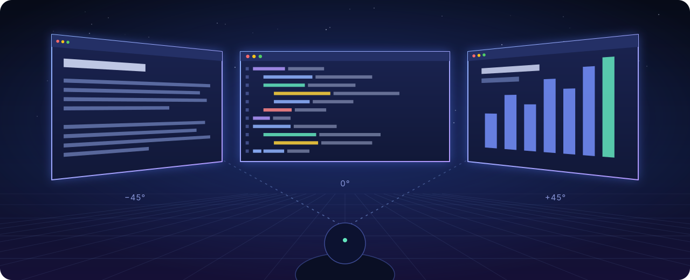
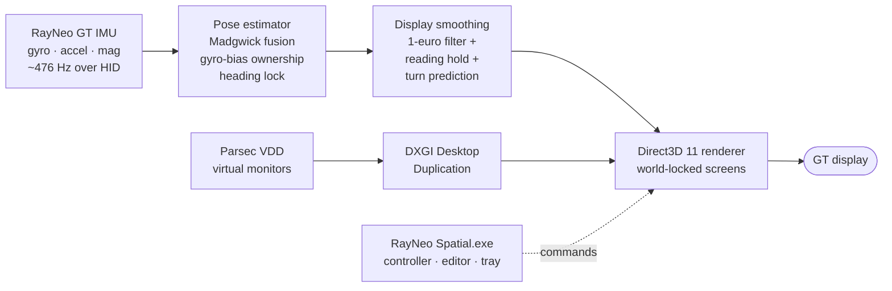

<div align="center">

# RayNeo Spatial

**Turn a pair of RayNeo GT glasses into a multi-monitor Windows workspace that floats around you.**

Real Windows desktops, world-locked in space and head-tracked from the glasses' own IMU,
with an optional compass lock against slow heading drift.

[](#requirements)
[](CMakeLists.txt)
[](src/render/)
[](#tests)
[](LICENSE)



</div>

---

## Highlights

<table>
<tr>
<td width="50%" valign="top">

### Real desktops, not mirrors
Creates genuine Windows monitors through the Parsec Virtual Display Driver. Drag apps onto
them as you would onto a physical screen. The default layout is three screens at −45°, 0° and
+45°, and you can arrange anything from 1 to 8.

</td>
<td width="50%" valign="top">

### Stays where you put it
A 3DoF pose estimator runs on the glasses' ~476 Hz IMU. An optional one-time compass
calibration ties heading to the local magnetic field, so the workspace does not slowly turn
the way a gyro-only heading can.

</td>
</tr>
<tr>
<td valign="top">

### Steady enough to read small text
A soft reading hold settles the view while your head is still, like electronic image
stabilisation, without making deliberate turns feel sticky. Choose Off, Low, Medium (default),
High or Ultra, live, from the Comfort page or with a hotkey.

</td>
<td valign="top">

### Comfortable for long sessions
Optional per-screen dimming: set each screen yourself, or let the screens you aren't looking
at fade. Add a warm night tint, and pull the cursor home to the centre screen with
<kbd>Ctrl</kbd>+<kbd>Alt</kbd>+<kbd>F</kbd>.

</td>
</tr>
<tr>
<td valign="top">

### A native control centre
A Win32 app with a first-run setup guide, in-app calibration, a 2D/3D layout editor, presets,
live engine controls, a tray icon and health checks for the glasses, the calibration, the
driver and the engine.

</td>
<td valign="top">

### Logs that are there when you need them
When a session longer than 10 minutes ends, its logs are compressed into `logs/sessions/`
automatically, and the newest three are kept. A session that ended in an engine failure is
always kept, whatever its length, as a separate `failed-session-*.zip` (also the newest
three). Each archive can be replayed offline.

</td>
</tr>
</table>

## How it works



`RayNeo Spatial.exe` is the controller. It launches and steers `spatial_desk.exe`, the rendering
engine. The engine takes over the display topology, creates the virtual monitors, captures each
one, and draws them on the glasses from the head pose. When you stop, it restores your original
display arrangement. `orientation_calibrate.exe` measures how the sensor sits on your head; the
controller runs it for you.

## Requirements

| | |
|---|---|
| **Glasses** | RayNeo GT on USB, set to **Extend** (<kbd>Win</kbd>+<kbd>P</kbd> → Extend) so they appear as a separate display. 1920×1080 at 120 Hz gives the best feel. |
| **OS** | Windows 10 (1809 or later) or Windows 11, x64 |
| **Virtual monitors** | The signed Parsec VDD driver, installed by you (it is never bundled or installed by this project; see step 1 below). Without it, **Start preview** still renders labelled test screens. |
| **The app** | A staged portable folder (`RayNeoSpatial\`). To make one yourself, see [Build from source](#build-from-source). |

## Quick start

These steps assume you have the portable folder, with `RayNeo Spatial.exe`, `spatial_desk.exe`
and `orientation_calibrate.exe` side by side. Nothing needs installing apart from the driver.

1. **Install the Parsec virtual display driver** (needed for real desktops; skip it to try
   **Start preview** first). Download `parsec-vdd-0.45.0.0.exe` from
   `https://builds.parsec.app/vdd/` and run it. Then run
   `C:\Program Files\Parsec Virtual Display Driver\vddinstall.bat` from an elevated
   (Run as administrator) prompt: the installer only extracts files, and the script registers
   the device.
2. **Connect the glasses** and press <kbd>Win</kbd>+<kbd>P</kbd> → **Extend**. In Windows
   display settings, set them to 1920×1080 at 120 Hz.
3. **Open `RayNeo Spatial.exe`.** On first launch a setup guide walks you through:
   - **Glasses**: read-only checks of the display, Extend mode, the motion sensor and the driver,
     each with a fix and **Check again**.
   - **Head calibration**: put the glasses on, sit upright and press **Start calibration**.
     Follow the prompts: hold still, then turn left, nod down and tilt right, three times each.
     Each step starts by itself after a 5-second countdown (**Start now** skips the wait), and a
     guide appears on the glasses showing which way to move. **Cancel** stops it and changes nothing.
   - **Compass** (optional, recommended): wear what you normally wear, earbuds included, and
     switch **Earbuds in** on if they are in. Stay away from magnets. The 45-second take asks you
     to turn all the way round once (a swivel chair works), then nod, tilt and look around.
   - **Layout**: keep the current layout or pick a starter arc, then **Finish**.

   You can skip either calibration, or the whole guide with **Skip setup**.
   **Settings → Run setup guide** opens it again.
4. **Press Start workspace** on Home. Your virtual desktops appear around you, and the laptop
   panel switches off until you stop. When Home shows
   **Hold your head still**, look straight ahead and keep still for a second or two: this is when
   the engine measures the gyro bias, and moving here was the biggest source of early drift.
5. **Recenter** any time with <kbd>Ctrl</kbd>+<kbd>Shift</kbd>+<kbd>R</kbd> while looking straight ahead.
6. **Stop** from Home or the tray icon. The engine removes the virtual desktops and restores
   your original displays; the controller waits up to a minute for that to finish.

> [!NOTE]
> Calibration is per device and per wearer. It is saved as `config/orientation.json` in the
> app folder and deliberately kept out of Git. Never copy another machine's file. Redo the head
> calibration (Tracking page → **Calibrate now**) if nodding visibly tilts the screens.

## Using the app

A sidebar switches between six pages (<kbd>Ctrl</kbd>+<kbd>1</kbd> … <kbd>Ctrl</kbd>+<kbd>6</kbd>).
Every setting has a `?` hover help.

| Page | What it holds |
|---|---|
| **Home** | Start workspace / Start preview, or Recenter / Reload layout / Stop while running; a **Readiness** checklist with a fix for each problem; startup steps; live head angles |
| **Layout** | Presets, the arrangement editor, the screen list and the selected screen's settings |
| **Comfort** | Reading stabilisation, screen dimming, night tint, cursor to centre |
| **Tracking** | Yaw/pitch tracking, preview without head tracking, **Turn prediction**, the compass lock status, and both calibrations (**Calibrate now**, **Calibrate compass**, or **Open in console**) |
| **Diagnostics** | Health checks, **Recover displays**, the engine log and logs folder |
| **Settings** | Theme (Dark, Light, Match Windows), keep running in the notification area, **Run setup guide**, shortcuts, version and paths, Quit |

**Layouts.** Starter arcs are Single, Triple (default), Quad, Five and Wide. **Save as preset**
stores the current arrangement under a name you choose (`triple` and `ultrawide` ship), and
**Delete preset** removes the loaded one. **Add** and **Remove** change the screen count (1 to 8).
Drag screens on the 2D map, or switch to **3D** (optionally fullscreen) to drag them in space and
orbit the view. Nothing is written until **Save and apply** (<kbd>Ctrl</kbd>+<kbd>S</kbd>), which
also reloads the running engine; **Revert** discards unsaved edits.

**Comfort.** Reading stabilisation: Off, Low, Medium (default), High, Ultra. Screen dimming: Off,
Manual (a brightness slider per screen) or Focus (the screen you look at stays bright, the
others fade). Night tint warms every screen, with a warmth slider. All apply live.

**Turn prediction** shows the world slightly ahead during fast head turns so it keeps up with
you: Off, 20, 35 (default) or 50 ms. Raise it if screens trail a quick turn, lower it if they
overshoot when you stop. It has no effect while you read, and applies at the next start.

Calibration needs the sensor to itself, so stop the engine before calibrating.

## Hotkeys

These work from anywhere while the engine runs:

| Keys | Action |
|---|---|
| <kbd>Ctrl</kbd>+<kbd>Shift</kbd>+<kbd>R</kbd> | Recenter the workspace in front of you |
| <kbd>Ctrl</kbd>+<kbd>Alt</kbd>+<kbd>S</kbd> | Cycle reading stabilisation: Off → Low → Medium → High → Ultra |
| <kbd>Ctrl</kbd>+<kbd>Alt</kbd>+<kbd>F</kbd> | Move the cursor to the middle of the centre screen |
| <kbd>Ctrl</kbd>+<kbd>Alt</kbd>+<kbd>Y</kbd> / <kbd>P</kbd> | Toggle yaw / pitch tracking (off holds the view on that axis) |
| <kbd>Ctrl</kbd>+<kbd>Alt</kbd>+<kbd>Q</kbd> or <kbd>Ctrl</kbd>+<kbd>Shift</kbd>+<kbd>\\</kbd> | Exit the workspace (stops the engine and restores your displays) |

In the controller window: <kbd>Ctrl</kbd>+<kbd>1</kbd> … <kbd>6</kbd> switch pages,
<kbd>Ctrl</kbd>+<kbd>S</kbd> saves and applies the layout, <kbd>Tab</kbd> and the arrow keys move
focus and adjust controls, and <kbd>Esc</kbd> leaves the fullscreen editor or otherwise hides the
window to the tray (or quits, if *Keep running in the notification area* is off).

## Reading stabilisation, measured

Replaying a recorded worn session (235 s of reading) through the real smoother:

| Level | Text motion while reading | Turn lag (rms) |
|---|---:|---:|
| Off | 31.0 px/s | 1.18° |
| Low | 11.1 px/s | 1.40° |
| Medium | 6.7 px/s | 1.57° |
| High | 5.2 px/s | 1.71° |

**Ultra** goes further. On a second recorded session (266 s of reading) it cut High's 5.4 px/s to
**2.3 px/s**, at the cost of more lag on turns (1.70° → 2.59° rms).

The hold works only on the displayed view. It never feeds back into the estimator, so tracking
accuracy is the same at every level.

## Troubleshooting

| Problem | What to do |
|---|---|
| Readiness says the glasses display is missing | Check the cable, then <kbd>Win</kbd>+<kbd>P</kbd> → **Extend**. Duplicate and PC-screen-only modes hide the glasses. **Check again** (setup guide) or **Refresh** (Diagnostics) re-runs the checks. |
| You chose "Disconnect this display" for the glasses in Windows Settings | Start workspace tries to reattach the glasses itself. If they stay missing, open Windows display settings and extend the desktop to them again. |
| The laptop display stays off, or the glasses vanished after a crash or sleep | Diagnostics → **Recover displays** re-applies Windows' Extend mode and your taskbar setting. If that is not enough, press <kbd>Win</kbd>+<kbd>P</kbd>. |
| Start workspace is disabled: Parsec VDD not installed | Install it (Quick start step 1) or use **Start preview**, which renders labelled test screens and needs no driver (the engine's `--no-virtual-displays` mode). |
| The calibration buttons are disabled | Stop the engine first; it and the calibration both need the sensor. The compass also needs a head calibration first. |
| The centre screen is off to one side | Recenter (<kbd>Ctrl</kbd>+<kbd>Shift</kbd>+<kbd>R</kbd>). If it keeps happening, do the compass calibration, and hold still when the app asks at startup. |
| Nodding tilts the screens instead of moving them | Redo the head calibration, wearing the glasses the way you normally do. |
| A hotkey does nothing | Another app may already own it; `logs/engine.log` lists any hotkey it could not register. |
| Anything else | Diagnostics → **Open engine log** or **Open logs folder**. See [Logs and diagnostics](#logs-and-diagnostics). |

## Logs and diagnostics

The Diagnostics page shows live health checks for the glasses display, the HID sensor, the
calibration, the driver, the layout and the engine. Each engine session starts on fresh files in
`logs/`:

| File | Contents |
|---|---|
| `engine.log` | The engine's console output |
| `engine-status.txt` | The engine's current state, which the controller reads |
| `telemetry.csv` | Pose, bias, rest and adaptation state (the dashboard reads the newest row) |
| `imu_raw.csv` | Every IMU sample, for offline replay |
| `sessions/session-YYYY-MM-DD_HH-MM-SS.zip` | Sessions longer than 10 minutes, compressed; the newest three are kept |
| `sessions/failed-session-YYYY-MM-DD_HH-MM-SS.zip` | Sessions whose engine failed, any length; the newest three are kept, separately |

When a session that ran for more than 10 minutes ends (stopped, quit, exited or crashed), its
files are compressed into `logs/sessions/` in the background; quitting never waits for it, and
anything interrupted is finished the next time the controller starts. Shorter successful
sessions are not archived: their files stay in `logs/` until the next session starts. A
session that ended in an engine failure is kept whatever its length: its files stay in `logs/`
(so the engine log can still be opened) and the next Start archives them as
`logs/sessions/failed-session-*.zip`, newest three kept, separately from normal sessions.
To investigate a session, extract its `imu_raw.csv` and replay it through the real estimator
with `imu_replay` from a source build:

```cmd
build\rayneo\imu_replay.exe imu_raw.csv --orientation config\orientation.json --observe --stats
```


## Build from source

You need Visual Studio 2022 Build Tools (C++), CMake 3.25+, Ninja and
[vcpkg](https://github.com/microsoft/vcpkg); the manifest pulls in `hidapi` and `nlohmann-json`.
From a *Developer Command Prompt for VS 2022*:

```cmd
set "VCPKG_ROOT=C:\path\to\vcpkg"
cmake -S . -B build\rayneo -G Ninja -DCMAKE_BUILD_TYPE=RelWithDebInfo -DCMAKE_TOOLCHAIN_FILE="%VCPKG_ROOT%\scripts\buildsystems\vcpkg.cmake"
cmake --build build\rayneo
ctest --test-dir build\rayneo --output-on-failure
```

Then stage the portable folder used by the Quick start (`dist\RayNeoSpatial`). It holds the
controller, engine, calibration tool, `hidapi.dll`, config and docs, and never includes your
calibration unless you pass `-IncludeCalibration`:

```powershell
powershell -ExecutionPolicy Bypass -File scripts\stage-portable.ps1 -BuildDir build\rayneo
```

Nothing is installed or pinned; `scripts\create-start-menu-shortcut.ps1` makes a Start Menu
shortcut you can pin. The [Windows app guide](docs/WINDOWS-APP.md) covers the controller in depth.

## Tests

Eleven CTest suites run offline, without the glasses:

| Suite | What it proves |
|---|---|
| `camera_selftest` | Frame conversion between the Z-up sensor and the Y-up renderer |
| `pose_selftest` | Recenter coupling, startup calibration, bias bounds, drift behaviour |
| `pose_scenarios` | 30 synthetic worn-head scenarios through the real estimator and smoother, from micro-adjustments to 5-minute sessions, startup confirmation and turn prediction |
| `mag_heading_selftest` | The heading-lock control loop, the hard-iron fit and the opt-in earbud tracker |
| `orientation_calibration_selftest` | Guided-calibration maths, rejection gates, repeats and the progress protocol |
| `protocol_selftest` | The GT's HID framing and nine-axis report decoding |
| `layout_selftest` | Layout parsing, validation and geometry |
| `vdd_selftest` | Parsec VDD protocol and display-topology logic |
| `view_selftest` | "Virtual glasses": the real layout and camera projected to the screen |
| `app_selftest` | The controller: config, presets, engine protocol, setup guide, calibration progress, view comfort, the session log archive |
| `ui_snapshot` | Offscreen renders of every controller page at several sizes, DPIs and both themes, with layout checks |

## Repository guide

| Path | Purpose |
|---|---|
| [`src/imu/`](src/imu/) | HID protocol, calibration, fusion, pose estimator, heading lock, smoother |
| [`src/render/`](src/render/) | Camera transform, screen geometry, D3D11 renderer |
| [`src/capture/`](src/capture/) | DXGI Desktop Duplication with a GDI fallback |
| [`src/vdd/`](src/vdd/) | Parsec VDD client and display-topology takeover and restore |
| [`src/layout/`](src/layout/) | Layout schema, validation, persistence |
| [`src/app/`](src/app/) | The engine, its command protocol and the view-comfort model |
| [`src/app_shell/`](src/app_shell/) | The Win32 controller, setup guide, calibration runner, tray, engine lifecycle and diagnostics |
| [`src/tools/`](src/tools/) | Calibration, probe, replay and test executables |
| [`docs/`](docs/) | [Windows app guide](docs/WINDOWS-APP.md) · [protocol notes](docs/PROTOCOL-NOTES.md) · [orientation calibration](docs/orientation-calibration.md) |
| [`AGENTS.md`](AGENTS.md) | Engineering notebook: invariants, the full bug history and every tuning trade-off with its measurement |

## Design notes

- **Frames are explicit.** The fused quaternion is right-handed with Z up; the Direct3D scene is
  left-handed with Y up. One exact basis change connects them, and the relative rotation is taken
  in the earth frame with its heading split out, so recentering with a tilted head never turns a
  nod into a roll.
- **One owner for steady error.** Gyro-bias adaptation is the only thing allowed to remove drift,
  and the published pose is always live: rest detection gates *adaptation*, never the pose, so
  sub-degree head movements are never swallowed.
- **Measured, not guessed.** Every gate and constant was chosen against a recorded failure, and
  each fix comes with a scenario that fails before it and passes after.
  [AGENTS.md](AGENTS.md) tells the whole story.

## Limitations

- Without the compass calibration there is no absolute heading reference, so a very slow,
  steady turn is indistinguishable from gyro drift. The estimator favours your deliberate pans,
  and recenter is one keypress away. On a recorded session, most of the gyro-only heading error
  came from a head movement during the startup measurement rather than from the gyro warming up: hence the
  *Hold your head still* step.
- A magnetic field that changes while you work (a magnet, a speaker, a laptop lid moving near your
  head) is detected and ignored rather than corrected.
- The glasses must be in Extend mode; duplicate or single-display modes hide them from the engine.
- Several recent features (the calibration guide on the glasses, calibration cancel, the startup
  reseed, the turn prediction horizon) are so far verified only on synthetic data and recordings.

## Contributing

Issues and pull requests are welcome. Please read [AGENTS.md](AGENTS.md) first: it lists the
invariants that must not break, and the IMU path expects a regression scenario with every change.

## License

Copyright 2026 Akshay Reddy Gujjula. Licensed under the [Apache License 2.0](LICENSE).

RayNeo Spatial is an independent project, not an official RayNeo product. It builds on
[hidapi](https://github.com/libusb/hidapi) and [nlohmann/json](https://github.com/nlohmann/json),
and speaks the protocol of the separately installed [Parsec VDD](https://github.com/nomi-san/parsec-vdd).
See the [third-party notices](docs/THIRD_PARTY_NOTICES.md).
